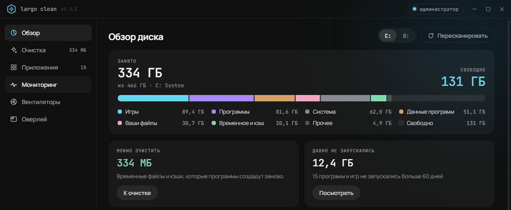
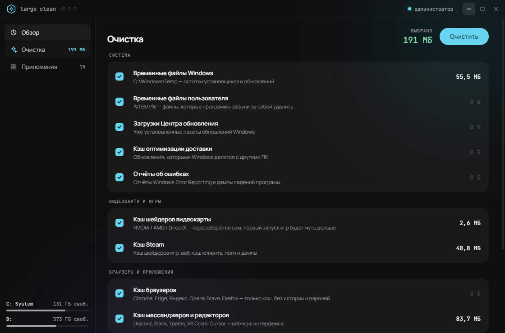
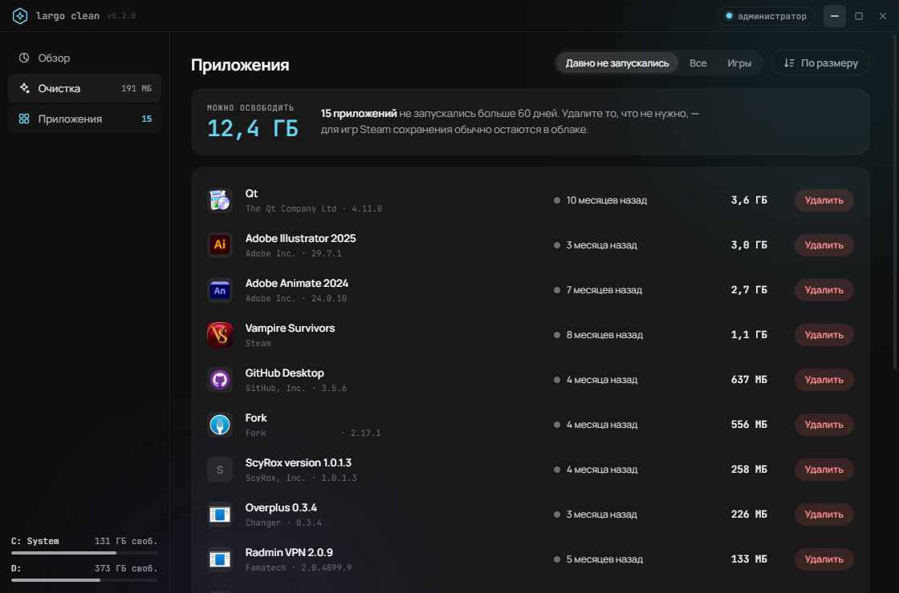
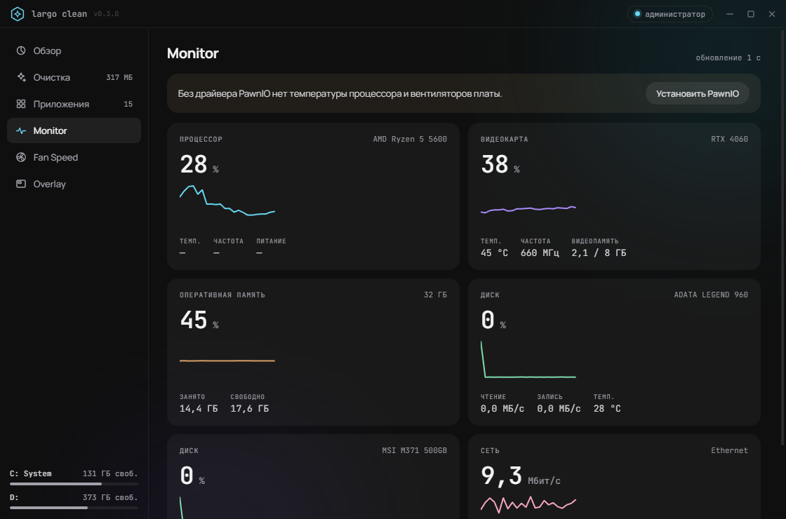
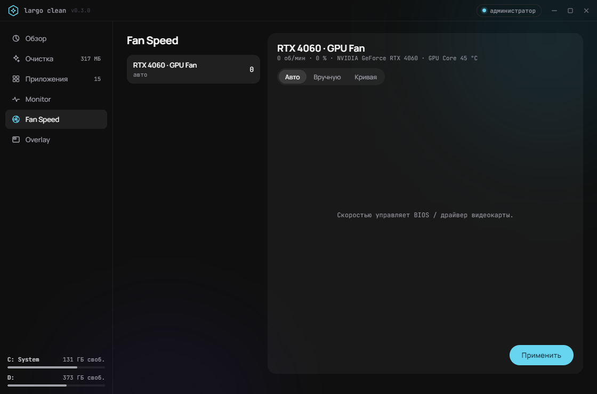
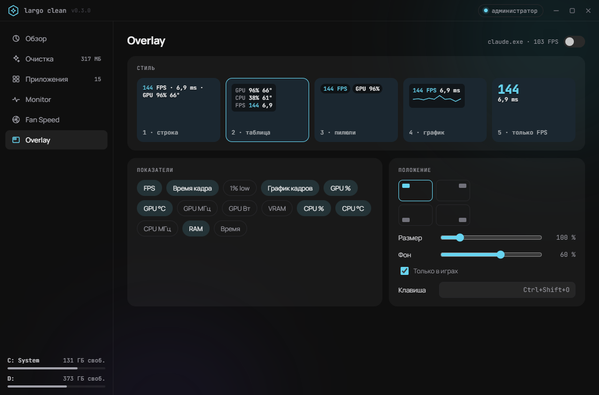

# Largo Clean

Анализ диска, очистка кэшей, неиспользуемые приложения, мониторинг железа, управление вентиляторами и оверлей с FPS поверх игр. Windows 10/11.













## Установка

Скачайте `LargoClean-win.zip` из [последнего релиза](https://github.com/largodevelop/Largo-Clean/releases/latest), распакуйте в любую папку и запустите `Largo Clean.exe`. Новые версии приложение предлагает установить само: значок в заголовке окна.

Запускается с правами администратора. Для температуры процессора и вентиляторов платы нужен драйвер [PawnIO](https://pawnio.eu): кнопка «Установить PawnIO» в разделе Monitor.

## Запуск из исходников

```
npm install
npm run build:native
npm start
```

Нужен .NET SDK 8+ для `build:native`.

Сборка: `npm run build`, выпуск релиза: `npm run release`.
